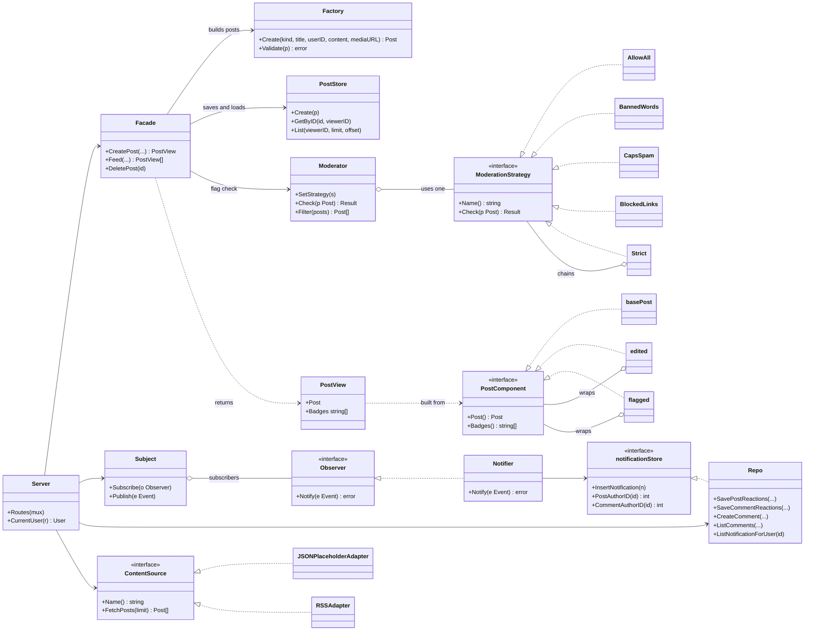
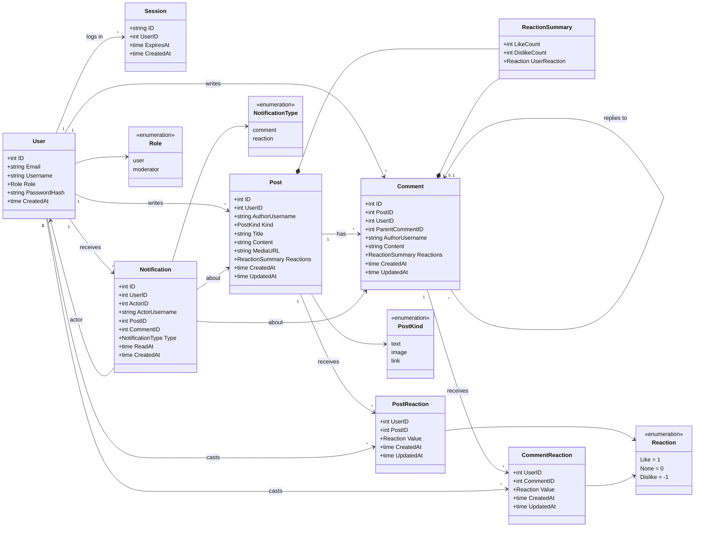

# Final Project — Social Media Feed
The project is implemented in Go using the standard library for HTTP routing and vanilla JavaScript on the client side, forming a lightweight Single Page Application.

## Authors – Group SE-2534:
- Nuraly Auyelkhan
- Yeren Yedige
- Muratov Anuar

## Structure of the project:
```text
├── cmd/
│   └── server/
│       └── main.go              
├── internal/
│   ├── adapter/                  # Pattern Adapter
│   │   └── adapter.go
│   ├── api/                      # HTTP handlers
│   │   ├── api.go
│   │   ├── auth.go
│   │   ├── external.go
│   │   ├── moderation.go
│   │   └── posts.go
│   ├── auth/                     # Users, sessions logic
│   │   ├── repository.go
│   │   └── service.go
│   ├── decorator/                # Pattern Decorator
│   │   └── decorator.go
│   ├── facade/                   # Pattern Facade
│   │   ├── facade.go
│   │   └── facade_feed.go
│   ├── factory/                  # Pattern Factory
│   │   └── factory.go
│   ├── observer/                 # Pattern Observer
│   │   ├── notif_test.go
│   │   ├── notificationRepository.go
│   │   └── observer.go
│   ├── store/                    # Database operations (SQLite)
│   │   ├── db.go
│   │   └── post_store.go
│   ├── strategy/                 # Pattern Strategy
│   │   └── strategy.go
│   ├── structs/                  # Data structures / Domain structss
│   │   └── struct.go
│   └── schema.sql                # SQL миграции / создание таблиц
├── web/                          # Front-end
│   ├── css/
│   │   ├── main.css
│   │   └── social.css
│   ├── js/
│   │   ├── main.js
│   │   └── social.js
│   │              
│   └── index.html     
├── go.mod                        # Go module file
├── app.db             # File of the SQLite Database
└── README.md                     # Documentation
```

## UML Diagram:

### Design patterns (all patterns included)



### Data structures (backend part)



## 6 design patterns:
Adapter: Acts as a "translator" for external sources (JSONPlaceholder API, RSS feeds). Downloads data in other formats (JSON, XML) and brings them to a single ContentSource domain interface and the internal structure of the Post.

Observer: Implements a notification system. Monitors events within the system (new comment, reaction) and sends alerts to target users without tightly linking components.

Strategy: Controls the logic of the moderation panel. It allows you to switch text verification algorithms on the fly (strict verification, search for forbidden words, link blocking) without changing the main handler code.

Factory / Builder: Responsible for encapsulating the logic of creating posts. Performs strict data validation (length limits in UTF-8 runes, content type checking) before the object gets into the database layer.

Facade: Hides the complex logic of feed aggregation. It provides controllers with a simple interface for receiving posts, collecting data from the database and external adapters in a single stream under the hood.

Decorator: Dynamically expands the basic functionality of services (for example, by adding logging, access control, or caching) without interfering with their original code.

## Database - SQLite 

SQLite is a powerful database for listing settings and user info.

## Functionality 
- Content creation block
- Post feed
- Social Interaction and Notifications
- Moderation and processing of posts
- Integration of external content

## How to run
```bash
go run ./cmd/server
```
Open http://localhost:8080. The first registered user becomes a moderator.

## How to run tests

```bash
go test ./...
```